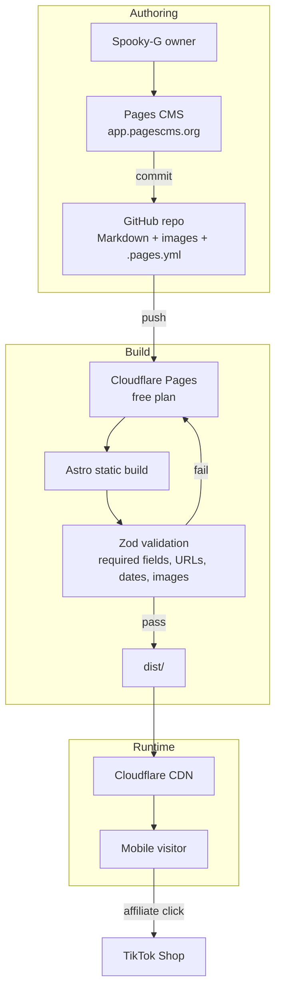
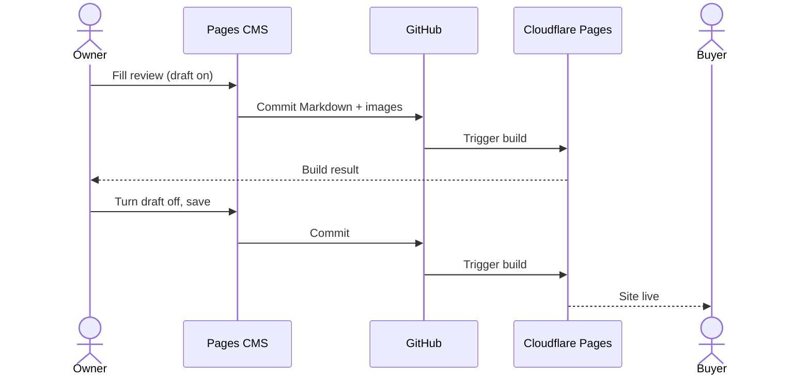

# Spooky-G — Implementation Specification

**Status:** APPROVED FOR BUILD — **authoritative build document**
**Prepared by:** Creatives
**Date:** 2026-10-19 (revision 3 — mascot applied)
**Supporting:** `product-brief.md`, `features.md`, `ux-design.md`, `content-model.md`

> **Forge instruction.** Build exactly what is written here. Nothing more. If something is unclear, ask — do not invent features, dependencies, or architecture. This revision deliberately removed most of the earlier complexity; putting it back is a scope change, not an implementation detail.

---

## 1. Summary and MVP Scope

A static, mobile-first product-review site for TikTok Shop shoppers in the Philippines, branded as **Spooky-G** — *No fluff. Just assurance. Boo ~*

Six public pages, two content things, zero backend, zero paid services.

### 1.1 Build this

| | |
|---|---|
| Pages | `/`, `/reviews/`, `/reviews/[slug]/`, `/about/`, `/affiliate-disclosure/`, `404` |
| Content | `reviews` collection (Markdown) + `site.yml` settings file |
| Stack | Astro (static) + TypeScript + Tailwind CSS 4 + Pages CMS + GitHub + Cloudflare Pages |
| Launch content | 10 reviews, 5 fixed categories, site settings filled in |
| Publishing | Owner publishes from Pages CMS; never writes code |
| Hosting | Free Cloudflare Pages on `pages.dev` |

### 1.2 Do not build

Accounts, comments, ratings, wishlists, price tracking, recommendations, notifications, dashboards, user reviews, checkout, payments, scraping, AI features, search, category pages, related reviews, comparison pages, newsletter, RSS, video embeds, analytics, dark mode, multi-language, and anything needing a database or server.

### 1.3 Non-negotiable rules

1. No invented reviews, ratings, counts, or seller approvals.
2. Every review states whether it was hands-on or research-based.
3. Every review shows a seller check with a date, and carries the line: *a seller check is what we saw on that date — it is not proof of authenticity*.
4. The affiliate link is the official TikTok Shop link, disclosed, never shortened or wrapped, and never shown when it is expired or the seller is unchecked.
5. No TikTok logos or claims of endorsement. The site is independent.
6. No backend, database, or authentication.
7. Nothing may be published without passing build-time validation.

---

## 2. Architecture



**Data flow, in one paragraph:** the owner edits a Markdown file in Pages CMS; Pages CMS commits it to GitHub; GitHub triggers a Cloudflare Pages build; Astro validates every review, generates static HTML for each published review, and copies images; Cloudflare serves the files from its CDN. There is no database and no runtime request handling.

| Concern | Decision |
|---|---|
| Rendering | Static only. No adapter, no SSR, no Functions |
| Data | Files in Git. Two things: reviews, site settings |
| Images | Plain files in `public/images/`, served by the CDN |
| Search | None. Category filter only |
| Analytics | None in MVP |
| Redirects | None. No link shortener, no affiliate wrapper |

---

## 3. Technology Choices

| Choice | Why | Not used |
|---|---|---|
| Astro | Static HTML by default, content collections built in, near-zero JS | Next.js, Nuxt, SvelteKit, Remix |
| TypeScript (strict) | Catches schema mistakes before the build fails | — |
| Tailwind CSS 4 via `@tailwindcss/vite` | Small compiled CSS, no runtime | `@astrojs/tailwind`, CSS-in-JS |
| Pages CMS | Free, Git-native, `.pages.yml` config, no custom admin to build | Strapi, Sanity, Decap, a custom admin |
| GitHub | Content history, rollback, CMS integration | — |
| Cloudflare Pages | Free static hosting, CDN, automatic deploys, dashboard rollback | Netlify, Vercel, Cloudflare Workers |
| `@astrojs/sitemap` | One official package for a correct sitemap | Hand-written XML |

### 3.1 Dependency budget

Runtime and build dependencies stay at five:

```
astro
typescript
tailwindcss + @tailwindcss/vite
@astrojs/check
@astrojs/sitemap
```

Deliberately **not** installed: image-processing libraries, test runners, browser-automation tools, analytics scripts, icon packs, component kits, form libraries, and HTTP clients.

> If a ticket seems to need a new dependency, stop and ask. The answer is almost always “do it in ~20 lines of Astro instead.”

### 3.2 Removed from the previous revision

| Removed | Reason |
|---|---|
| Categories collection + category pages | A dropdown filter is enough at this size |
| Pages collection (methodology, about, disclosure) | Two short pages belong in site settings |
| Nested seller-check and affiliate objects | Flat fields are simpler to fill in and validate |
| Evidence lists, source lists, score fields | The review body covers them; scores are false precision |
| Search index endpoint | No search feature |
| JSON-LD components | No structured review/product markup in MVP |
| Playwright, Vitest, axe, link checker | Manual checklist covers a site this size |
| Custom image optimisation script | Size cap + reserved aspect ratio is enough |
| Analytics and its privacy surface | TikTok already reports affiliate activity |

---

## 4. Repository Structure

```text
/
├── public/
│   ├── images/
│   │   ├── reviews/          # product photos (CMS uploads)
│   │   └── site/             # mascot.png, mascot-head.png, og-image.png
│   ├── favicon.svg
│   └── _headers
├── scripts/
│   └── check-images.mjs      # size guard (Node built-ins only)
├── src/
│   ├── components/           # 16 components, listed in §6
│   ├── content/
│   │   └── reviews/
│   ├── data/
│   │   └── site.yml
│   ├── layouts/
│   │   └── BaseLayout.astro
│   ├── lib/
│   │   ├── reviews.ts        # queries and sorting
│   │   ├── affiliate.ts      # link age → state
│   │   └── format.ts         # dates, text helpers
│   ├── pages/
│   │   ├── index.astro
│   │   ├── reviews/
│   │   │   ├── index.astro
│   │   │   └── [slug].astro
│   │   ├── about.astro
│   │   ├── affiliate-disclosure.astro
│   │   ├── 404.astro
│   │   └── robots.txt.ts
│   ├── styles/
│   │   └── global.css
│   └── content.config.ts
├── .pages.yml
├── astro.config.mjs
├── package.json
├── tsconfig.json
└── README.md
```

### 4.1 Conventions

- Content files: `src/content/reviews/<slug>.md`.
- Components: PascalCase `.astro`. Helpers: camelCase `.ts`.
- Routes always end with a trailing slash.
- Dates stored as `yyyy-MM-dd`.
- No `any`. No inline `<style>` blocks except one global stylesheet.
- No component fetches data directly; pages pass typed content in.
- One commit per logical change so rollback is clean.

### 4.2 Scripts

```json
{
  "scripts": {
    "dev": "astro dev",
    "check": "astro check",
    "build": "astro check && astro build && node scripts/check-images.mjs",
    "preview": "astro preview"
  }
}
```

That is the whole toolchain. If a task seems to require more, it probably does not.

---

## 5. CMS Configuration and Content Schema

Full field definitions, sample content, and the planning-level `.pages.yml` are in `content-model.md`. Summary:

### 5.1 Two CMS entries

| Entry | Type | Path |
|---|---|---|
| Reviews | collection | `src/content/reviews` |
| Site settings | file | `src/data/site.yml` |

### 5.2 Review fields (24)

Required: `title`, `slug`, `category`, `reviewedFrom`, `verdictLabel`, `verdict`, `pros`, `cons`, `image`, `imageAlt`, `reviewedAt`, `sellerName`, `sellerCheckedAt`, `sellerNotes`, `draft`, `body`.

Optional: `brand`, `gallery`, `specs`, `sellerUrl`, `sellerStatus`, `affiliateUrl`, `affiliateAddedAt`, `tiktokVideoUrl`.

Fixed selects: category (5 values), `reviewedFrom` (2), `verdictLabel` (3), `sellerStatus` (3).

### 5.3 Key rules

- Filename comes from `slug`; the URL follows automatically.
- `draft` defaults to `true`, so nothing publishes by accident.
- Rename is disabled on reviews; URLs stay stable.
- `affiliateUrl` requires `affiliateAddedAt`.
- No references to other files. Nothing to break.

### 5.4 What the build rejects

Missing required fields, wrong select values, bad slug pattern, slug ≠ filename, missing alt text, missing image file, image over 1.5 MB, non-`https://` URL, affiliate URL without a date, future dates, empty pros or cons.

### 5.5 What the build warns about

Affiliate link older than 90 days; seller check older than 60 days.

### 5.6 Verified Pages CMS behaviour

Confirmed against current documentation: collections, single files, YAML frontmatter, string/text/date/select/boolean fields, object lists, image picker, rich text (Markdown), media sources, filename templates, create/rename/delete operations, commit settings.

Not relied upon (verify in V-02): branch switching, preview environments, upload size limits.

---

## 6. Routes and Component Contracts

### 6.1 Routes

| Route | Source | Indexable |
|---|---|---|
| `/` | Latest published reviews + site settings | Yes |
| `/reviews/` | All published reviews | Yes |
| `/reviews/[slug]/` | One published review | Yes |
| `/about/` | `site.about` | Yes |
| `/affiliate-disclosure/` | `site.defaultDisclosure` | Yes |
| `404` | Latest reviews | No |
| `/robots.txt` | Static | No |
| `/sitemap-index.xml` | `@astrojs/sitemap` | No |

Draft reviews generate no page. Unknown slugs hit the 404.

### 6.2 Components

| Component | Props | Behaviour |
|---|---|---|
| `BaseLayout` | `title`, `description`, `image?`, `noindex?` | `<html lang="en">`, skip link, header, main, footer |
| `SiteHeader` | `siteName` | Wordmark + mascot mark, nav, `<details>` mobile menu |
| `SiteFooter` | `contactEmail`, `tiktokProfileUrl?` | Disclosure summary, links, small mascot mark |
| `Mascot` | `variant: 'full' \| 'head'`, `size?` | Renders `mascot.png` or `mascot-head.png`; CSS ghost fallback if the file is missing |
| `ReviewCard` | `review` | Image, title, brand, category, verdict label, date. Whole card is one link |
| `CategoryFilter` | `categories`, `active` | Rounded chips; `aria-pressed`; works without JS by showing all |
| `ReviewHeader` | `review` | Image, title, brand, category, basis badge, date |
| `VerdictCard` | `review`, `affiliateState` | Verdict pill, one-line verdict, CTA slot |
| `AffiliateCta` | `state`, `url?`, `addedAt?` | Four states; `rel="sponsored nofollow noopener"`; disclosure |
| `SellerCheck` | `review` | Store, date, status chip, notes, authenticity disclaimer |
| `ProsCons` | `pros`, `cons` | Two lists; stacked on mobile |
| `SpecList` | `specs` | Definition list; omitted entirely when empty |
| `ReviewBody` | `body` | Rendered Markdown |
| `Disclosure` | `text`, `href` | Inline commission note |
| `StatusChip` | `variant`, `label` | Coloured pill; always includes text |
| `SeoHead` | `title`, `description`, `image?` | Title, description, canonical, OG, Twitter card |

Sixteen components. No component holds content of its own.

### 6.3 Affiliate state logic

Computed in `src/lib/affiliate.ts`:

| State | Condition | Output |
|---|---|---|
| `none` | No `affiliateUrl` | “No affiliate link for this one right now.” |
| `expired` | `affiliateAddedAt` older than 100 days | “This link expired — look for the product in TikTok Shop.” |
| `old` | 91–100 days | Button + “This link is old. Availability may have changed.” |
| `hidden` | `sellerStatus` is `not-checked` | “We haven't checked this store yet, so we're not sending you to it.” |
| `active` | Otherwise | Button + disclosure |

---

## 7. Publishing Workflow



| Action | Owner does | Result |
|---|---|---|
| Create | Reviews → Create, fill fields | Draft file committed; no public page |
| Publish | Turn **Draft** off, save | Cloudflare builds; page goes live in minutes |
| Edit | Change fields, save | Rebuild; live version updates |
| Unpublish | Turn **Draft** on | Page disappears on the next successful build |
| Delete | Delete entry | Page disappears; Git history keeps the file |
| Restore an old version | Revert in Git, or roll back in Cloudflare | Previous version returns |
| Edit site text | Site settings | About, hero intro, contact, disclosure update |

**Build failure:** the previous deployment stays live. The log names the file and the field. Fix and save again.

**Not instant:** a save is a commit plus a build. The owner needs to know this, and it goes in the runbook.

---

## 8. SEO, Performance, Accessibility, Affiliate Compliance, Security

### 8.1 SEO basics

- Unique title and meta description per page.
- Self-referencing canonical URL with trailing slash.
- Open Graph and Twitter card tags; OG image from `site.ogImage`.
- `sitemap.xml` lists published pages only; excludes drafts and the 404.
- `robots.txt` allows crawling and points to the sitemap.
- 404 returns HTTP 404 with `noindex`.
- No structured review/product markup in MVP — it risks misleading search results for a small affiliate site.

### 8.2 Performance

- Static HTML; no framework runtime.
- System fonts; zero font download.
- One small client-side script for the category filter; the site works without it.
- Images: 1.5 MB cap enforced at build, fixed aspect-ratio containers, lazy loading below the fold, hero eager.
- Caching: hashed assets and images cache for one year; HTML revalidates.

```text
/_astro/*
  Cache-Control: public, max-age=31536000, immutable

/images/*
  Cache-Control: public, max-age=31536000, immutable
```

Target: usable on a mid-range phone over mobile data. No CLS from images (space is reserved).

### 8.3 Accessibility

- Landmarks, one `h1`, sequential headings, skip link.
- Full keyboard operation; visible focus on everything clickable.
- Contrast ≥ 4.5:1 body text; ≥ 3:1 large text and UI.
- Status always paired with text, never colour alone.
- Alt text required for product images; decorative marks use `alt=""`.
- Tap targets ≥ 44 px; body text ≥ 16 px.
- Reduced motion respected; no autoplay or flashing.
- Usable at 200% zoom and at 320 px.

Verified by a manual pass, not by test tooling.

### 8.4 Affiliate compliance

- Only the official TikTok Shop product link, generated in the app, pasted unchanged.
- Never shortened, wrapped, redirected, or tracked by us.
- Visible disclosure beside every link, plus `/affiliate-disclosure/`.
- `rel="sponsored nofollow noopener"` and `target="_blank"`.
- No link when expired, or when the seller is unchecked.
- Link age shown honestly; no claims about availability or price.
- Site name contains no “TikTok Shop”; no TikTok logos or trademarked graphics.
- Footer states the site is independent and not affiliated with TikTok.
- No purchase claims, no self-referral encouragement, no fake urgency.

### 8.5 Security and privacy

```text
/*
  X-Content-Type-Options: nosniff
  Referrer-Policy: strict-origin-when-cross-origin
  X-Frame-Options: DENY
  Permissions-Policy: geolocation=(), camera=(), microphone=()
  Content-Security-Policy: default-src 'self'; img-src 'self' data:; style-src 'self' 'unsafe-inline'; script-src 'self'; base-uri 'self'; form-action 'self'; frame-ancestors 'none'
```

- No analytics, no cookies, no tracking of any kind in MVP.
- No backend, no forms, no user input, no accounts.
- All external URLs must start with `https://`; validated at build.
- No secrets in the repository. No TikTok credentials anywhere.
- GitHub and Cloudflare accounts use 2FA.
- Pages CMS GitHub App installed on this repository only.

---

## 9. Tickets

Estimates: **S** ≤ half a day, **M** 1–2 days. Total ≈ 8–12 developer days.

### 9.1 Verification first

| ID | Ticket | Size | Depends | Done when |
|---|---|---|---|---|
| V-01 | Verify the TikTok affiliate link workflow | S | — | Owner generates three real product links, confirms the commission preview is visible, records the exact link format and host, confirms age verification is done, confirms links work from an external website and expire after at most 100 days. Written down before any link ships. |
| V-02 | Verify Pages CMS media upload | S | — | In a test repo: create a review with the draft `.pages.yml`, upload a JPG and a WebP, confirm the filename template `{fields.slug}.md` works, confirm the draft toggle saves, record the maximum upload size. |
| V-03 | Collect launch inputs | S | — | Mascot files prepared and placed (`mascot.png`, `mascot-head.png`, `og-image.png` in `public/images/site/`), contact email confirmed, five categories agreed, first ten products listed with real affiliate links. |

### 9.2 Foundation

| ID | Ticket | Size | Depends | Done when |
|---|---|---|---|---|
| T-01 | Scaffold the project | S | V-03 | Astro + strict TypeScript + Tailwind 4 + `@astrojs/sitemap`; `site` set to the `pages.dev` URL; trailing slashes on; `npm run check` and `npm run build` pass on an empty project. |
| T-02 | Content schema and validation | M | T-01, V-03 | `reviews` collection and site settings schema; Zod enforces every rule in §5.4 and §5.5; the sample review from `content-model.md` builds; an intentionally broken review fails with a message naming the file and field. |
| T-03 | `.pages.yml` for Pages CMS | S | T-02, V-02 | Config loads in Pages CMS; all 24 review fields appear in a sensible order; image fields point at the right media source; rename disabled; delete enabled; `draft` defaults to `true`. |
| T-04 | Brand shell | M | T-01 | Design tokens from `ux-design.md` (including the mascot-sampled palette: `--ink #1B1E27`, `--accent #4C63D2`); `BaseLayout`, `SiteHeader`, `SiteFooter`, `Mascot`, `SeoHead`; skip link; working mobile menu without JavaScript; mascot renders on the hero, masthead, About and 404 with a CSS fallback when the file is missing. |

### 9.3 Pages

| ID | Ticket | Size | Depends | Done when |
|---|---|---|---|---|
| T-05 | Review detail page | M | T-02, T-04 | All sections render in the order in `ux-design.md` §5.3; drafts generate no page; unknown slug returns 404; metadata unique; no price, score, or rating anywhere. |
| T-06 | Seller check block | S | T-05 | Store name, check date, status chip, notes, optional listing link; the authenticity disclaimer is visible on every review; `not-checked` hides the affiliate link. |
| T-07 | Affiliate link, disclosure, states | M | T-05, V-01 | All five states from §6.3 render correctly; `rel` attributes correct; disclosure visible; link age computed from `affiliateAddedAt`; expired and missing links show plain messages. |
| T-08 | Review listing and filter | M | T-05 | Cards correct and newest-first; filter chips work by hiding cards; full list readable with JavaScript disabled; empty state shown; result count announced to screen readers. |
| T-09 | Homepage | S | T-04, T-08 | Mascot hero with tagline; brand intro from site settings; latest reviews; single primary action; no animation beyond hover. |
| T-10 | About and disclosure pages | S | T-04 | About renders `site.about`, contact email, and the privacy line; disclosure page renders `site.defaultDisclosure`; both editable from site settings; both have unique metadata. |
| T-11 | Routing, 404, sitemap, robots | S | T-05, T-10 | Six routes only; 404 returns HTTP 404 and is `noindex`; sitemap lists published pages and excludes drafts; robots references the sitemap; canonical URLs correct on every page. |

### 9.4 Launch

| ID | Ticket | Size | Depends | Done when |
|---|---|---|---|---|
| T-12 | Image size guard | S | T-01 | `scripts/check-images.mjs` walks `public/images`, fails the build for any file over 1.5 MB naming the file; uses Node built-ins only; documented in the README. |
| T-13 | Responsive and accessibility pass | M | T-08, T-09, T-11 | Verified at 320/375/390/768/1024/1440 px with no horizontal scroll; keyboard pass complete; focus visible; contrast checked; alt text present; reduced motion respected; 200% zoom usable. |
| T-14 | Publish 10 real reviews | M | T-03, T-11 | Ten genuine reviews live, each with verdict, pros/cons, seller check, date, alt text, and a verified affiliate link or a deliberate “no link” note. No placeholders. |
| T-15 | End-to-end CMS acceptance | M | T-14 | Owner creates, publishes, edits, unpublishes, and deletes a test review; uploads images; edits site settings; a deliberate validation error fails the build and the previous site stays live. |
| T-16 | Deploy and rollback drill | S | T-15 | Site live on `pages.dev`; a rollback to the previous deployment succeeds; the failed-build path is confirmed. |
| T-17 | Owner runbook and launch checklist | S | T-16 | One-page runbook: sign in, create, upload, publish, unpublish, delete, fix a failed build, roll back, quarterly link refresh. Launch checklist signed off. |

### 9.5 Order

```
V-01  V-02  V-03
        │
T-01 ───┴──► T-02 ──► T-03
  │             │
  └──► T-04     ├──► T-05 ──► T-06
                │      └──► T-07
                │      └──► T-08 ──► T-09
                └──► T-10 ──► T-11
                              │
T-12 ─────────────────────────┤
T-13 ─────────────────────────┤
                              ▼
                            T-14 ──► T-15 ──► T-16 ──► T-17
```

**First working end-to-end path:** V-03 → T-01 → T-02 → T-03 → T-04 → T-05 → T-06 → T-07 → T-14. Get one real review live through the CMS before building anything else.

---

## 10. Testing and Launch

### 10.1 How this project is tested

No test runner. A site this size is verified by a build gate plus a manual checklist.

| Check | How |
|---|---|
| Types and schema | `npm run check` |
| Content validity | `npm run build` fails on bad content |
| Images | `node scripts/check-images.mjs` |
| Local review | `npm run dev`, then the checklist below |
| Pre-launch | Full checklist once, on a real phone |

### 10.2 Acceptance tests

| ID | Scenario | Expected |
|---|---|---|
| AT-01 | Open homepage | Mascot hero, brand intro, latest reviews, valid metadata |
| AT-02 | Open listing, use filter | Cards correct; filter works; readable without JS; empty state |
| AT-03 | Open a review | Exact item, verdict, pros/cons, body, basis badge, date present |
| AT-04 | Seller check | Store, date, notes, status chip, authenticity disclaimer visible |
| AT-05 | Affiliate states | `active`, `old`, `expired`, `none`, `hidden` all correct; rel attributes and disclosure present |
| AT-06 | About page | Brand, mission, review basis, contact, privacy note |
| AT-07 | Bad URL | 404 page, HTTP 404, noindex, recovery links |
| AT-08 | SEO basics | Titles, descriptions, canonical, OG, sitemap, robots correct |
| AT-09 | Images | Uploaded images render, alt text present, 1.5 MB guard enforced |
| AT-10 | Responsive + a11y | 320 px, keyboard, focus, contrast, 200% zoom |
| AT-11 | Invalid content | Build fails with a message naming the file and field |
| AT-12 | CMS end-to-end | Create → publish → edit → unpublish → delete; deploy and rollback verified |

### 10.3 Launch checklist

**Content**
- [ ] 10 real reviews, no placeholders, no invented claims
- [ ] Every review has: verdict, pros, cons, body, seller check, date, alt text
- [ ] Every affiliate link generated in TikTok and verified (V-01)
- [ ] Disclosure visible beside every link and on `/affiliate-disclosure/`
- [ ] Authenticity disclaimer on every review
- [ ] Mascot renders on hero, masthead, About, and 404; About and contact text written
- [ ] No TikTok logos; independence statement in the footer

**Build and hosting**
- [ ] `npm run check` and `npm run build` pass
- [ ] Live on `pages.dev` over HTTPS
- [ ] Edit in the CMS → site updates after a build
- [ ] A failed build leaves the live site untouched
- [ ] Rollback tested

**Quality**
- [ ] Six routes only; 404 works
- [ ] Sitemap lists published pages; robots points to it
- [ ] Canonical and social preview tags correct on every page
- [ ] No horizontal scroll at 320 px
- [ ] Keyboard navigation complete; focus visible
- [ ] Contrast checked; alt text present
- [ ] Works with JavaScript disabled

**Operations**
- [ ] Owner has the runbook and has published one review unaided
- [ ] Quarterly refresh reminder set for links and seller checks

### 10.4 Deployment

1. Push the repository to GitHub.
2. Create a Cloudflare Pages project, connect the repo.
3. Build command `npm run build`; output `dist`.
4. Deploy. Note the `pages.dev` address.
5. Update `site` in `astro.config.mjs` if the address differs from the plan.
6. Connect Pages CMS to the same repository.
7. Load `.pages.yml`, walk through one review end to end.
8. Sign off the checklist.

### 10.5 Environment and secrets

| Item | Value |
|---|---|
| `site` | `astro.config.mjs` — the public site URL |
| Secrets | **None.** The project stores no API keys or tokens |
| TikTok credentials | Never stored, never requested |
| `.env` | Not needed. Do not create one |

Analytics are deliberately absent, so there is no beacon token to manage.

### 10.6 Free-tier headroom

| Limit | Free plan | This site |
|---|---|---|
| Cloudflare builds | 500/month | ~20/month |
| Cloudflare files | 20,000 | ~200 |
| File size | 25 MiB | Capped at 1.5 MB by our own rule |
| Static requests | Unlimited | — |
| GitHub repo | 10 GB recommended | ~50 MB |
| Pages CMS | Free | One editor |

No migration trigger is foreseeable. If reviews pass roughly 200, revisit storage and caching.

---

## 11. Risks and Fallbacks

| Risk | Level | Response | Fallback |
|---|---|---|---|
| Affiliate link format unknown | High | V-01 before any link ships | Publish reviews with no link and a plain note |
| Links expire (max 100 days) | High | Date stored per link; old/expired states shown | Owner refreshes quarterly; page stays useful without a link |
| Seller information goes stale | Medium | Check date on every review; quarterly reminder | Set status to `not-checked`, which hides the link |
| Pages CMS cannot do something assumed | Low | V-02 tests it up front | Simplify to a text path for that one field |
| Build fails on bad content | Medium | Validation names file and field; previous site stays live | Owner fixes and saves again |
| Owner stops maintaining | Medium | Quarterly checklist; unpublish rather than leave stale pages | Fewer live reviews, all accurate |
| Mascot file missing at build | Low | CSS ghost fallback in the `Mascot` component | Site still looks finished |
| Free-tier ceiling reached | Low | Headroom is enormous | Not expected within the next year |

### 11.1 Out of scope for this build

Everything in `features.md` §6 and §7, plus any new dependency, any new page, any new content field, and any new feature discovered during the build. Raise it; do not absorb it.

---

## 12. Definition of Done and Forge Handoff

### 12.1 Done means

- [ ] All tickets V-01 → T-17 complete.
- [ ] Six routes live; nothing else exists.
- [ ] 10 real reviews published, each passing validation.
- [ ] Owner published, edited, unpublished, and deleted a review without help.
- [ ] `npm run check`, `npm run build`, and the image check pass.
- [ ] All four affiliate states verified with real data.
- [ ] Disclosure and authenticity disclaimer present everywhere required.
- [ ] Accessibility checklist completed by hand.
- [ ] Sitemap, robots, canonical, and 404 verified on the live site.
- [ ] Failed build and rollback both exercised.
- [ ] Runbook written and understood by the owner.
- [ ] Zero paid services required.
- [ ] No dependency beyond the five listed in §3.1.

### 12.2 Handoff instructions for Forge

1. Read all five documents. This file is the build contract.
2. Run V-01, V-02, V-03 before writing code.
3. Build in ticket order. Do not start T-09 before T-05 works.
4. Do not add dependencies, pages, fields, or features. If one seems necessary, ask.
5. Do not create sample or placeholder reviews that could reach production. Sample content stays as a draft.
6. Do not shorten, wrap, or redirect the affiliate link.
7. Keep the site independent: no TikTok logos, no trademarked graphics, no endorsement claims.
8. Validate content at build time; never work around a failing build by deleting a rule.
9. Keep commits small so rollback is clean.
10. Verify on a real phone before declaring anything done.

### 12.3 Deliverables

- [ ] Deployed site on `pages.dev` (or a domain the owner already owns)
- [ ] Repository with `.pages.yml` and `README.md`
- [ ] 10 published reviews and completed site settings
- [ ] Completed launch checklist
- [ ] One-page owner runbook
- [ ] Short note of anything that was deferred or deviated from, with reasons

---

## Appendix A — Open Questions

| Question | Default until answered |
|---|---|
| Mascot background removal | Supplied artwork has a studio backdrop; V-03 produces a transparent `mascot.png` and a head crop. If removal is not possible, the mascot renders only on a `--bg-soft` panel |
| Custom domain | `pages.dev` |
| Real contact email | Owner supplies before launch |
| Exact affiliate link host | V-01 verifies it; no allowlist until then |
| PH disclosure wording | Plain-language disclosure; confirm before scaling traffic |
| Adding categories | One-line edit in `.pages.yml` by a developer |
| Pageviews | Not tracked; TikTok reports affiliate activity |

## Appendix B — Sources

Verified 2026-10-19:

- TikTok Shop Academy PH — Affiliate Links Guide for Creators: links work outside the app, age verification required, links valid up to 100 days. https://seller-ph.tiktok.com/university/essay?knowledge_id=1614664065681153&lang=en
- TikTok Shop Academy PH — Affiliate Links Programme: no “TikTok Shop” in the site name; no TikTok logos or trademarks without permission. https://seller-ph.tiktok.com/university/essay?knowledge_id=304203273848577&lang=en
- Pages CMS docs: collections, fields, media, operations, filenames. https://pagescms.org/docs/
- Astro docs: content collections and static output. https://docs.astro.build/
- Cloudflare Pages limits: 500 builds/month, 20,000 files, 25 MiB per file. https://developers.cloudflare.com/pages/platform/limits/

Unverified and handled by tickets: exact affiliate link host (V-01), Pages CMS upload size (V-02), PH legal wording (owner).

## Appendix C — Traceability

| Feature | Journey | Content | Route / component | Ticket | Test |
|---|---|---|---|---|---|
| F-01 Homepage | J1 | `site.*`, latest reviews | `/` · `Mascot`, `ReviewCard` | T-04, T-09 | AT-01 |
| F-02 Listing + filter | J2 | title, category, verdictLabel, reviewedAt, image | `/reviews/` · `ReviewCard`, `CategoryFilter` | T-08 | AT-02 |
| F-03 Review detail | J2, J3 | `reviews.*` | `/reviews/[slug]/` · `ReviewHeader`, `VerdictCard` | T-05 | AT-03 |
| F-04 Seller check | J3 | seller fields | `SellerCheck` | T-06 | AT-04 |
| F-05 Affiliate + disclosure | J3 | affiliateUrl, affiliateAddedAt | `AffiliateCta`, `Disclosure` | T-07 | AT-05 |
| F-06 About | J4 | `site.about`, contactEmail | `/about/` | T-10 | AT-06 |
| F-07 CMS workflow | J5 | all content | `.pages.yml` | T-02, T-03, T-12, T-15 | AT-12 |
| F-08 Routing + SEO | all | routes | sitemap, robots, 404 | T-11 | AT-07, AT-08 |
| F-09 Responsive + a11y | all | presentation | layout + components | T-13 | AT-10 |
| F-10 Deploy + rollback | J5 | all content | GitHub + Cloudflare | T-01, T-16, T-17 | AT-12 |

**Gate checks**

- [x] Every launch feature maps to a journey, content fields, a route/component, a ticket, and a test.
- [x] Tickets are dependency-ordered and individually testable.
- [x] No paid-only requirement.
- [x] No hidden backend, database, or auth assumption.
- [x] No invented claims, ratings, or authenticity promises.
- [x] Affiliate safety kept: V-01, disclosure, expiry states, no link when unchecked.
- [x] Accessibility kept as manual essentials, without test tooling.
- [x] Open questions labelled with defaults.
