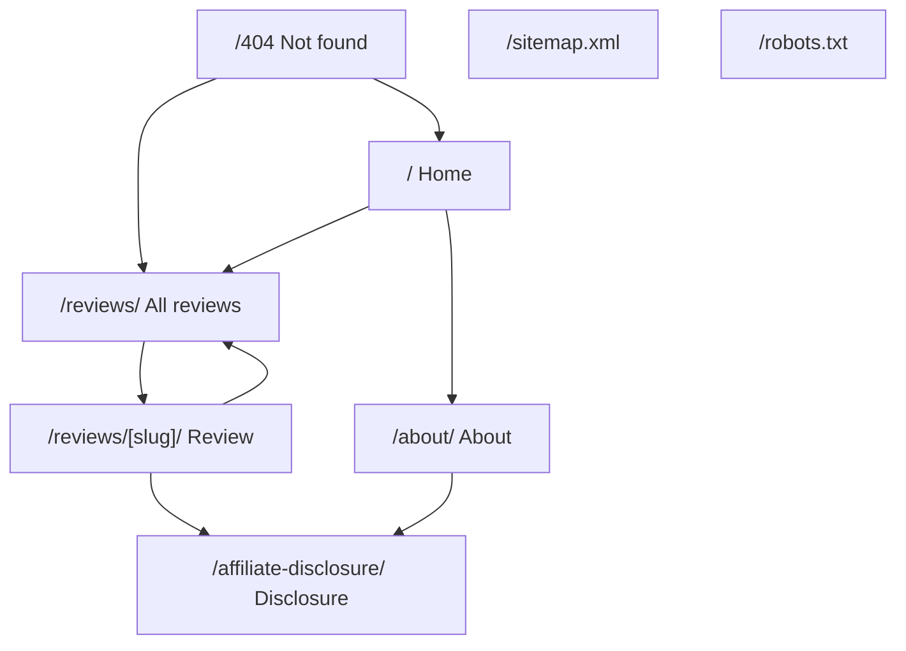

# Spooky-G — UX Design

**Status:** Approved for build — mascot applied
**Prepared by:** Creatives
**Date:** 2026-10-19 (revision 3)
**Build source of truth:** `implementation.md`

---

## 0. The Mascot

Spooky-G's mascot has been supplied: a soft, rounded 3D ghost in **white**, wearing **black sunglasses** and a **backwards dark navy cap**, giving a **peace sign** with a relaxed half-smile.

The artwork sets the tone for everything else: cool, unhurried, a bit cheeky, never loud.

**What the mascot tells us about the design:**

| Mascot detail | Design response |
|---|---|
| White body, soft shading | White and soft-neutral page backgrounds |
| Black sunglasses and dark cap | The dark ink colour for text and primary buttons |
| Cool blue/lilac rim light | The single accent colour (cool indigo) |
| Backwards cap, casual | Rounded, unfussy shapes; no sharp corners |
| Half-smile, peace sign | Copy stays short, lowercase-ish, lightly playful |
| Studio lighting, clean backdrop | Generous whitespace, one soft shadow only |

### 0.1 Asset handling

The supplied artwork is a square-ish studio render on a light backdrop, not a transparent PNG. Before build, prepare these three files:

| File | Source | Purpose |
|---|---|---|
| `mascot.png` | Full body, transparent background | Homepage hero, About page |
| `mascot-head.png` | Tight head-and-shoulders crop, transparent | Masthead mark, favicon |
| `og-image.png` | Mascot on `--ink` background, 1200×630 | Social preview |

Guidance:

- Remove the backdrop (background removal) so the mascot sits cleanly on white and on soft-neutral cards.
- Keep the ghost's white body intact; do not tint it.
- Do not re-render or restyle the artwork.
- If a transparent version is not available, place the mascot only on a `--bg-soft` panel so the original backdrop blends, and never crop tightly through the edges.

**Alt text (use as-is):** “Spooky-G mascot: a smiling white ghost wearing black sunglasses and a backwards dark cap, making a peace sign.”

**Fallback:** if a mascot file is missing at build time, render a simple CSS ghost mark so the site never shows a broken image.

---

## 1. Design Principles

1. **Answer fast.** On a phone, the product, the verdict, and the link decision must be visible without scrolling far.
2. **Four pages, done well.** No clever structure for its own sake.
3. **Honest, not cute.** The mascot sets the tone; it never appears inside a disclaimer.
4. **Rounded, airy, modern.** White space, soft borders, no heavy shadows or gradients — the way the mascot itself is lit.
5. **Fast on mobile data.** System fonts, small CSS, minimal JavaScript.
6. **One action per screen.** “Check this listing” is the only button that matters on a review.

---

## 2. Brand System

### 2.1 Voice

The mascot's half-smile and peace sign set the register: **cool and unhurried, not gaggy.**

| Use this | Not this |
|---|---|
| “Checked on 12 Oct 2026.” | “We did a super deep investigation!” |
| “No affiliate link for this one right now.” | “Oopsie! Link broke, soz.” |
| “A seller check is what we saw that day. It isn’t proof of authenticity.” | Any joke near a disclaimer |
| “Worth it” / “Mixed” / “Skip it” | Star ratings, scores, “amazing” |
| “Boo ~” once per page, maximum | Ghost emoji in every heading |

Short sentences. Lowercase where it reads naturally. Calm on purpose.

**Rule:** playfulness lives in headings, empty states, and the mascot. Facts, money, and safety stay plain.

### 2.2 Colour

Sampled from the supplied mascot artwork: the dark cap and sunglasses set the ink, the ghost's white body sets the background, and the cool rim light sets the accent.

| Token | Value | Use |
|---|---|---|
| `--bg` | `#FFFFFF` | Page background (ghost body) |
| `--bg-soft` | `#F2F1F6` | Card and section background (mascot backdrop) |
| `--ink` | `#1B1E27` | Sunglasses/cap dark. Text, primary buttons |
| `--ink-soft` | `#454A57` | Secondary text |
| `--muted` | `#7B8193` | Dates, captions |
| `--line` | `#E6E6EE` | Borders, dividers |
| `--accent` | `#4C63D2` | Cool indigo from the rim light. Links, focus ring, active states |
| `--accent-soft` | `#EDF0FC` | Accent tint background |
| `--good` | `#1F7A5C` | “Looks ok”, “Worth it” |
| `--warn` | `#9A5B00` | “Caution”, “Old link” |
| `--warn-soft` | `#FFF4E6` | Warning background |

Rules:

- White and soft-neutral dominate, exactly as the mascot is lit. Dark appears in text and primary buttons only.
- Accent is used sparingly; it is never a large fill.
- Green and amber are informational, never “good/bad” judgements about a seller.
- No TikTok brand colours or logos anywhere.

Contrast check (WCAG AA): `--ink` on `--bg` ≈ 15:1; `--accent` on `--bg` ≈ 5.2:1; `--good` and `--warn` on `--bg` both ≈ 5.2:1. All pass for body text and UI.

### 2.3 Type

System fonts only — no web-font download, no layout shift, no extra dependency.

| Role | Stack |
|---|---|
| Everything | `system-ui, -apple-system, "Segoe UI", Roboto, "Helvetica Neue", Arial, sans-serif` |

| Token | Mobile | Desktop |
|---|---|---|
| `h1` | 30 px | 40 px |
| `h2` | 22 px | 28 px |
| `h3` | 18 px | 20 px |
| Body | 16 px / 1.65 | 17 px / 1.65 |
| Meta | 13 px | 14 px |

Line length stays under ~70 characters for body text.

### 2.4 Shape and spacing

| Token | Value |
|---|---|
| `--r-sm` | 10 px — chips, tags |
| `--r-md` | 14 px — inputs, small buttons |
| `--r-lg` | 20 px — cards, panels |
| `--r-pill` | 999 px — primary buttons |
| Spacing scale | 4, 8, 12, 16, 24, 32, 48, 64, 96 |

- Rounded corners everywhere; no sharp corners.
- Borders (1 px `--line`) instead of shadows. One soft shadow only on the mascot hero card.
- Generous whitespace: sections are separated by 48–96 px, not by rules.

### 2.5 Mascot usage

Use the supplied artwork as-is. Do not redraw, recolour, or add effects.

| Placement | Treatment |
|---|---|
| Homepage hero | Full mascot, 160–220 px, beside/below the headline on a `--bg-soft` panel |
| Masthead | Head crop, 28–32 px, next to the wordmark |
| About page | Full mascot, 200–260 px, above the bio |
| 404 page | Head crop, 80–100 px, above the friendly message |
| Footer | Head crop, 20 px, low-contrast, beside the copyright line |
| Favicon / OG image | Head crop on an `--ink` background |

Rules: never on a review card, never beside a disclosure or seller note, never animated, never more than once per page apart from the masthead mark.

The mascot's sunglasses-and-cap silhouette should be the recognisable mark, so crops should always keep the cap and glasses in frame.

### 2.6 Icons and motion

- Inline SVG, 1.5 px stroke, 20 px. Only: arrow (external link), warning triangle, calendar, chevron.
- No TikTok logo, no shopping cart, no stars.
- Hover/focus transitions 120–150 ms. No entrance animations, no parallax, no autoplay.
- `prefers-reduced-motion` disables all transitions.

---

## 3. Information Architecture



Six pages. No category pages, no search page, no archive.

---

## 4. Journeys

### J1 — Viewer arrives from TikTok

1. Taps a bio or video link.
2. Lands on a review page (or the homepage if the link is generic).
3. Sees product name, image, verdict label, verdict line, and the seller check date.
4. Reads or skips to the affiliate button.
5. Taps → TikTok Shop opens in a new tab.

If the product is not the one from the video, the exact item details make that obvious immediately.

### J2 — Browser scans and filters

1. Opens `/reviews/` from the header, footer, or a shared link.
2. Scans cards: image, title, category, verdict label, date.
3. Taps a category chip; the list narrows instantly.
4. Opens a review.

With JavaScript disabled, the full list still renders and every card still works.

### J3 — Buyer checks trust

1. Reads the seller check: store, date, notes, status chip.
2. Sees the authenticity disclaimer.
3. Sees the disclosure next to the button.
4. Taps, or decides not to.

### J4 — Visitor evaluates the site

1. Opens `/about/` from the footer.
2. Reads who Spooky-G is and how reviews are written.
3. Finds the contact email and the privacy note.

### J5 — Owner publishes

1. Signs in to Pages CMS.
2. Creates a review: title, slug, category, verdict, pros/cons, body.
3. Uploads a hero image and writes alt text.
4. Adds seller name, check date, and notes.
5. Pastes the affiliate link and the date it was generated.
6. Leaves **Draft** on, saves, checks the preview build.
7. Turns Draft off, saves; Cloudflare deploys.
8. Opens the live page to confirm.

No code. No manual page creation. No new route to register.

---

## 5. Page Specifications

### 5.1 Homepage `/`

```
┌──────────────────────────────────────┐
│ 👻 Spooky-G      Reviews  About  ☰    │
├──────────────────────────────────────┤
│  ┌────────────────────────────────┐  │
│  │  ┌────────────┐                │  │
│  │  │  👻 mascot │  just a kewl  │  │
│  │  │  (full,    │  ghost        │  │
│  │  │   on soft  │  reviewing     │  │
│  │  │   panel)   │  TikTok finds.│  │
│  │  │            │  No fluff.    │  │
│  │  │            │  Just         │  │
│  │  │            │  assurance.   │  │
│  │  │            │  Boo ~        │  │
│  │  └────────────┘  [ Browse      │  │
│  └────────────────────────────────┘  │
├──────────────────────────────────────┤
│   Brand intro (CMS text, 1–2 lines)  │
├──────────────────────────────────────┤
│   LATEST REVIEWS                      │
│   ┌────────┐  ┌────────┐              │
│   │ card   │  │ card   │              │
│   └────────┘  └────────┘              │
│   ┌────────┐                           │
│   │ card   │                           │
│   └────────┘                           │
├──────────────────────────────────────┤
│   We may earn a commission …  [About]  │
│   👻 Footer · Not affiliated w/ TikTok │
└──────────────────────────────────────┘
```

The hero is a single rounded `--bg-soft` panel with one soft shadow: mascot on the left, headline and one button on the right. On phones the mascot sits above the headline at 160 px.

Notes: hero is text-first with the mascot supporting; single primary action; latest reviews capped at 6.

### 5.2 Review Listing `/reviews/`

```
┌──────────────────────────────────────┐
│ ☻ Spooky-G        Reviews  About  ☰  │
├──────────────────────────────────────┤
│   All reviews                         │
│   10 honest checks on TikTok finds.   │
│                                      │
│   (All) (Gadgets) (Kitchen) (Beauty)  │
│                                      │
│   ┌──────────────┐  ┌──────────────┐  │
│   │ [image]      │  │ [image]      │  │
│   │ Product      │  │ Product      │  │
│   │ Brand · Cat  │  │ Brand · Cat  │  │
│   │ Worth it     │  │ Mixed        │  │
│   │ 12 Oct 2026  │  │ 10 Oct 2026  │  │
│   └──────────────┘  └──────────────┘  │
└──────────────────────────────────────┘
```

- One column on phones, two on tablets, three on desktop.
- Whole card is one link. No nested buttons.
- Filter chips: rounded pills, 44 px tall, `aria-pressed` on the active one.
- Result count updates for screen readers (`aria-live="polite"`).
- Empty state: “No reviews here yet. Check back soon, boo.”

### 5.3 Review Detail `/reviews/[slug]/`

```
┌──────────────────────────────────────┐
│ ☻ Spooky-G        Reviews  About  ☰  │
├──────────────────────────────────────┤
│   [ image — 4:3, rounded 20px ]      │
│                                      │
│   Adjustable Phone Stand              │
│   ExampleBrand · Phone & Gadgets      │
│   (Hands-on tested)                   │
│   Reviewed 12 Oct 2026                │
│                                      │
│  ┌────────────────────────────────┐  │
│  │  WORTH IT                      │  │
│  │  Steady on a desk, pointless   │  │
│  │  for a tablet.                 │  │
│  │                                │  │
│  │  Best for: watching videos     │  │
│  │  Skip if: you need MagSafe     │  │
│  │                                │  │
│  │  [ Check this listing ↗ ]      │  │
│  │  We may earn a commission if   │  │
│  │  you buy through this link.    │  │
│  │  You pay no extra. [Details]   │  │
│  └────────────────────────────────┘  │
│                                      │
│   THE EXACT ITEM                      │
│   Brand · Variant · Pack size · Store │
│                                      │
│   PROS                CONS            │
│   + Stable            - No cable tray │
│   + Cheap            - Not for tablets│
│                                      │
│   THE REVIEW                          │
│   Short, honest paragraphs …         │
│                                      │
│   SELLER CHECK          [Looks ok]    │
│   Example Store PH                    │
│   Checked 12 Oct 2026                 │
│   Notes: title and pack size matched. │
│   ⚠ A seller check is what we saw on  │
│   that date. It is not proof of       │
│   authenticity.                       │
│                                      │
│   SPECS (if provided)                 │
│   Material … Height … Weight …        │
│                                      │
│   [ More reviews ]                    │
│   Disclosure · Footer                 │
└──────────────────────────────────────┘
```

Section order is fixed: image → identity → verdict card → exact item → pros/cons → review → seller check → specs → more reviews.

### 5.4 About `/about/`

```
┌──────────────────────────────────────┐
│      ┌──────────────────┐              │
│      │  👻 mascot       │              │
│      │  full, on a      │              │
│      │  --bg-soft panel │              │
│      └──────────────────┘              │
│   About Spooky-G                      │
│                                      │
│   Just a kewl ghost hanging around,   │
│   reviewing things.                   │
│   No fluff. Just assurance. Boo ~     │
│                                      │
│   What we do                          │
│   How we review                       │
│   • Hands-on tested                   │
│   • Research-based                    │
│   Seller checks                       │
│   Privacy                             │
│   Contact                             │
│   hello@…                             │
└──────────────────────────────────────┘
```

This is the one page where the mascot is the subject, so it gets the largest rendering (200–260 px) and sits above the bio rather than beside it.

### 5.5 Affiliate Disclosure `/affiliate-disclosure/`

Short and plain: what the link is, that commission may be earned, that the price is the same, that links can expire, and that reviews are not sponsored. One screen, no legalese.

### 5.6 404

```
┌──────────────────────────────────────┐
│              👻                        │
│        (head crop)                     │
│   This page ghosted out.               │
│   The link may be old or mistyped.     │
│                                      │
│   [ Browse reviews ]                  │
│                                      │
│   Latest: Review A · Review B         │
└──────────────────────────────────────┘
```

---

## 6. Components

Keep this list short. Every component earns its place.

| Component | Purpose | Key props |
|---|---|---|
| `SiteHeader` | Wordmark + mascot mark + nav + mobile menu | `siteName` |
| `SiteFooter` | Disclosure summary, links, contact, mascot mark | `siteName`, `contactEmail` |
| `Mascot` | Mascot image or fallback mark | `size`, `alt` |
| `ReviewCard` | Listing card | `review` |
| `CategoryFilter` | Filter chips | `categories`, `active`, `onChange` |
| `ReviewHeader` | Image, title, brand, category, badge, date | `review` |
| `VerdictCard` | Verdict label, verdict line, best for / skip if, CTA slot | `review`, `affiliateState` |
| `AffiliateCta` | Button + disclosure, or fallback message | `state`, `url`, `addedAt` |
| `SellerCheck` | Store, date, notes, status chip, disclaimer | `review` |
| `ProsCons` | Two short lists | `pros`, `cons` |
| `SpecList` | Definition list of specs | `specs` |
| `ReviewBody` | Rendered Markdown | `body` |
| `Disclosure` | Inline commission note | `text`, `href` |
| `StatusChip` | Verdict / seller status pill | `variant`, `label` |
| `SeoHead` | Title, description, canonical, OG | `title`, `description`, `image` |
| `Footer` (page) | Used by 404 only if needed | — |

Removed versus the previous revision: breadcrumbs, evidence lists, source lists, freshness labels, date stamps, JSON-LD components, empty-state framework, analytics component, pagination, table of contents.

---

## 7. States

### 7.1 Verdict label (3)

| Value | Label | Colour |
|---|---|---|
| `worth-it` | Worth it | `--good` |
| `mixed` | Mixed | `--warn` |
| `skip-it` | Skip it | `--ink-soft` |

### 7.2 Review basis (2)

| Value | Label |
|---|---|
| `hands-on` | Hands-on tested |
| `research` | Research-based |

Always visible near the title. Never hidden.

### 7.3 Seller status (3)

| Value | Label | Effect |
|---|---|---|
| `looks-ok` | Looks ok | Normal |
| `caution` | Caution | Amber chip + warning styling |
| `not-checked` | Not checked | Grey chip; **affiliate link hidden** |

### 7.4 Affiliate states (5)

State identifiers match `features.md` F-05 and `implementation.md` §6.3.

| State | Condition | UI |
|---|---|---|
| `active` | URL set, `affiliateAddedAt` ≤ 90 days ago, seller checked | Button + disclosure |
| `old` | 91–100 days | Button + “This link is old. Availability may have changed.” |
| `expired` | > 100 days | No button; “This link expired — look for it in TikTok Shop.” |
| `none` | No URL saved | No button; “No affiliate link for this one right now.” |
| `hidden` | `sellerStatus` is `not-checked` | No button; “We haven't checked this store yet, so we're not sending you to it.” |

Plus: seller check older than 60 days adds a quiet note under the seller block.

### 7.5 Empty and error states

| State | Message |
|---|---|
| No reviews published | “No reviews here yet. Check back soon, boo.” |
| Filter matches nothing | “Nothing in this category yet, boo.” + “Show all” |
| Image missing at build | Build fails with the file name |

---

## 8. Responsive Behaviour

| Width | Layout |
|---|---|
| 320–479 | Single column, 16 px padding, stacked pros/cons, full-width button |
| 480–767 | Single column, 20 px padding |
| 768–1023 | Two-column card grid |
| 1024–1279 | Three-column card grid, 24 px padding |
| 1280+ | Three-column grid, max width 1120 px |

Rules:

- No horizontal scroll at 320 px.
- Buttons and chips at least 44 px tall.
- Images always inside a fixed aspect-ratio box (`4:3` hero, `1:1` gallery) so nothing shifts while loading.
- Mobile menu uses `<details>`, so it works without JavaScript.
- Body text never below 16 px.

---

## 9. Accessibility Essentials

Target WCAG 2.2 AA, verified by hand rather than by test tooling.

- Landmarks: `header`, `nav`, `main`, `footer`.
- One `h1` per page; no skipped heading levels.
- Skip link to `#main`.
- Visible focus ring using `--accent` on every interactive element.
- Full keyboard operation: nav, filter chips, cards, buttons.
- Contrast: body text ≥ 4.5:1, large text and UI ≥ 3:1.
- Status never colour-only — chip always carries text.
- Alt text required for the hero and gallery; decorative marks use `alt=""`.
- Reduced motion respected.
- Usable at 200% zoom.
- External links open in a new tab with a screen-reader hint.

Manual check before launch: keyboard-only pass, one screen-reader spot check, contrast check, 320 px check.

---

## 10. Microcopy

| Context | Copy |
|---|---|
| Tagline | No fluff. Just assurance. Boo ~ |
| Primary CTA | Check this listing on TikTok Shop |
| CTA external hint | Opens in a new tab |
| Disclosure | We may earn a commission if you buy through this link. You pay no extra. |
| Authenticity disclaimer | A seller check is what we saw on that date. It is not proof of authenticity. |
| Link expired | This link expired — look for the product in TikTok Shop. |
| No link | No affiliate link for this one right now. |
| Old link | This link is old. Availability may have changed. |
| Not checked seller | We haven't checked this store yet, so we're not sending you to it. |
| Empty listing | No reviews here yet. Check back soon, boo. |
| 404 | This page ghosted out. |

---

## 11. Design QA Checklist

- [ ] Mascot present on homepage, masthead, about, and 404; absent from review cards and disclosures.
- [ ] Four core pages plus disclosure and 404 only.
- [ ] Works at 320 px with no horizontal scroll.
- [ ] Keyboard operation complete; focus visible.
- [ ] Contrast verified for all text and chips.
- [ ] Every image has alt text.
- [ ] Review section order matches §5.3.
- [ ] Affiliate states tested in all four forms.
- [ ] Authenticity disclaimer present on every review.
- [ ] Disclosure next to every link and on its own page.
- [ ] No TikTok logos or brand colours.
- [ ] No stock claims, prices, ratings, or urgency wording.
